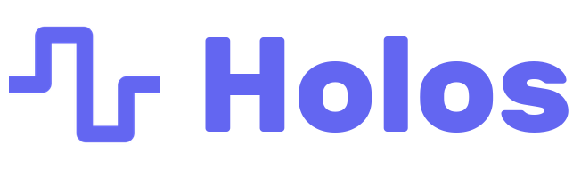
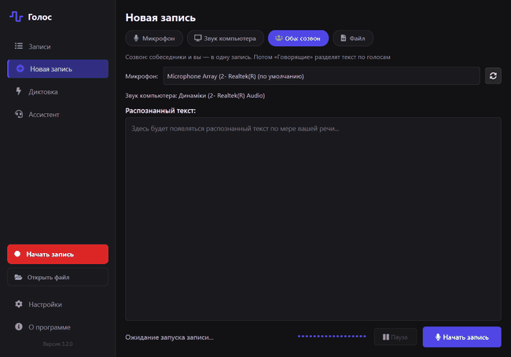
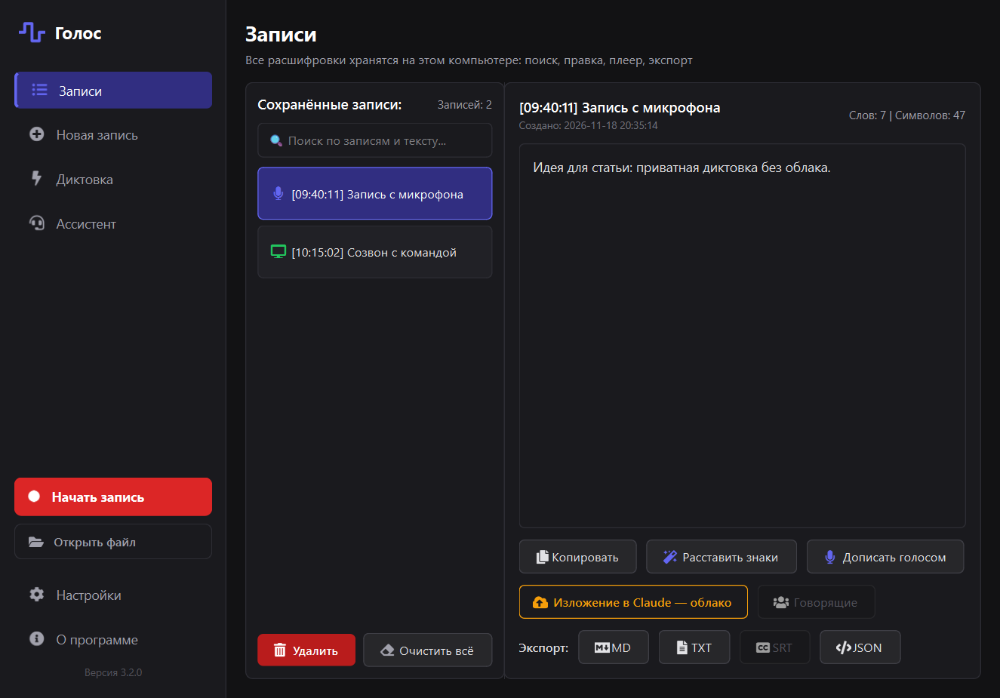
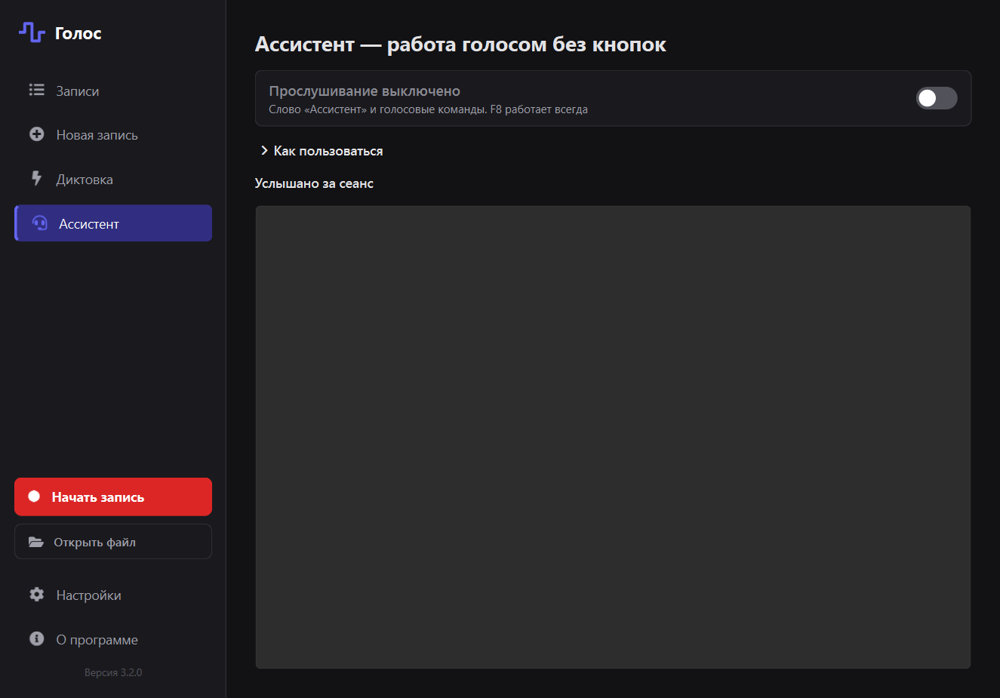
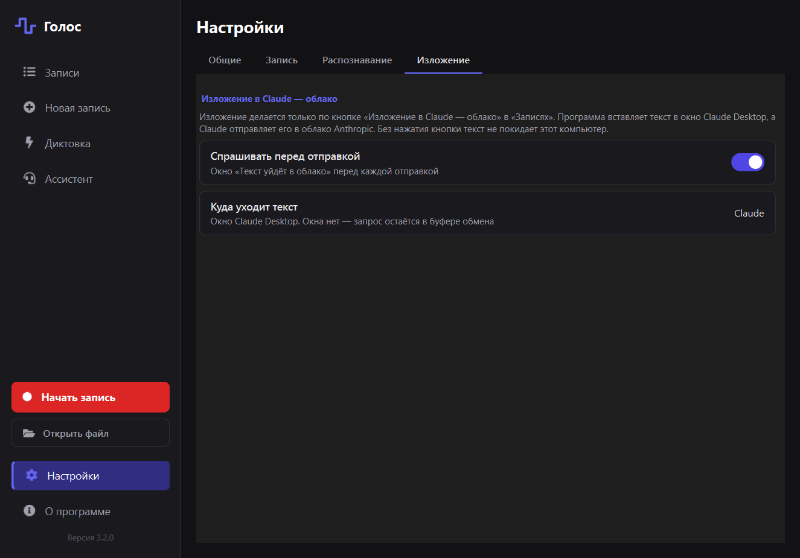

# Holos

[Русский](README.md) • [English](README.en.md)

**Speak — the text appears in any window. No internet, no subscription, free.**

### Open source • Your speech never leaves your computer • Free

---

Contents

- [Why Holos?](#why-holos)
- [Installation](#installation)
- [Features in action](#features-in-action)
- [How it differs](#how-it-differs)
- [Privacy](#privacy)
- [For developers](#for-developers)
- [Acknowledgements](#acknowledgements)
- [License](#license)

## Why Holos?

- **Private.** Speech is recognized on your computer. Sound and text go nowhere.
- **Free.** No subscription, no keys, no trial period.
- **No internet.** Works on a train, in a basement, during power cuts.
- **Made for Russian and Ukrainian.** The best open models for each language; punctuation is added automatically.

## Installation

| System | Download | What to do |
|---|---|---|
| **Windows 10 / 11 (x64)** | [Holos-Setup.exe](https://github.com/gof020466-stack/holos-app/releases/latest) | Double-click → language → folder → "Install". No administrator rights needed |
| **Update** | [Holos-Update.exe](https://github.com/gof020466-stack/holos-app/releases/latest) | Installs over the existing version, does not download the models again |
| **Linux** | coming soon | — |

> **Official builds are only on the [Releases](https://github.com/gof020466-stack/holos-app/releases) page.** Python and the models are inside the installer. Requirements: Windows 10 or 11, 64-bit; memory — 4 GB minimum, 8 GB recommended (the program with a loaded model uses about 0.9 GB); disk space — 2 GB; no graphics card needed; no internet needed.

After installation: cursor in any window → **F8** → speak → **F8**.

> **You can install it yourself in a few minutes.** Need help? We install it and teach you: set it up for your tasks and connect it to Claude. Write in [Issues](https://github.com/gof020466-stack/holos-app/issues) with the label "Installation".

## Features in action

### ⌨️ Dictation into any window
Press F8 — the text goes where the cursor is: an email, a messenger, a document. Hands-free: "start dictation" … "stop recording".

### 🎙️ Call recording
Zoom, Telegram, any call. The other people come from the computer sound, you come from the microphone, into one recording. Pause as often as you like — it stays one recording.

### 👥 Who said what
"Speakers" splits the transcript by voice — for a call and for any file.

### 📂 File transcription
Audio and video into text. A player above the text: click a word to jump to it.

### 🗣️ "Assistant" — voice commands
"Assistant, …" — the phrase goes to Claude Desktop and is sent automatically. Holos controls music itself: pause, louder, next.

### 📝 Summary — only on a button
What was discussed, decisions, tasks, who said what — via Claude. Before the first send, a warning.

### 📤 Export
A Markdown note for Obsidian, TXT, SRT subtitles for YouTube, JSON with the time of every word.

### 🌐 Three interface languages
Русский, українська, English.

## How it differs

| | Holos | Meetily (free version) |
|---|---|---|
| Recognition on your computer | yes | yes |
| Price | free | free; a paid Pro exists |
| Call recording | yes | yes |
| Who said what | yes | Pro only |
| Model for Russian | GigaAM v3 | Whisper |

Meetily data — from its README, November 2026.

## Privacy

- Recognition happens on your computer. No internet is needed to work.
- Recordings, texts and settings are stored only on your computer.
- The only path to the cloud is the "Summary in Claude" button. Before the first send, a warning.
- Update check — only if you agreed at first launch; you can turn it off in "Settings".
- The code is open: anyone can check this.

## For developers

Python; the recognition engine is [sherpa-onnx](https://github.com/k2-fsa/sherpa-onnx). The models are not in the repository. Program structure and installer build — [DEVELOPER.md](DEVELOPER.md). Bugs and ideas — in [Issues](https://github.com/gof020466-stack/holos-app/issues).

## Acknowledgements

- **Sber** — GigaAM v3 model (Russian).
- **NVIDIA** — Parakeet TDT v3; **moondream** — Parakeet Ultra, ONNX build — **mrfakename** (Ukrainian, English and other languages).
- **Alpha Cephei** — Vosk (service models: speech segmentation, voice commands).
- **pyannote** and **3D-Speaker** — models for speaker separation.
- **k2-fsa** — sherpa-onnx; **FFmpeg** (LGPL build).

Licenses of all models and libraries — [THIRD_PARTY_LICENSES.md](THIRD_PARTY_LICENSES.md).

## Code signing policy

Free code signing provided by [SignPath.io](https://about.signpath.io/), certificate by [SignPath Foundation](https://signpath.org/).

- Committers and reviewers: [gof020466-stack](https://github.com/gof020466-stack)
- Approvers: [gof020466-stack](https://github.com/gof020466-stack)

Every release is built by GitHub Actions from this repository and signed only after manual approval.

**Privacy policy:** this program will not transfer any information to other networked systems unless specifically requested by the user or the person installing or operating it. Details — see "Privacy" above.

## License

MIT. Use it freely.

Authors: Buck + Claude, 2026.
