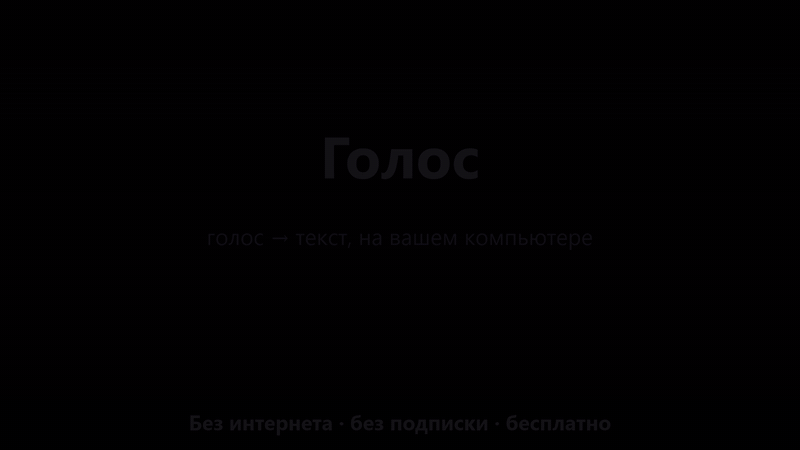
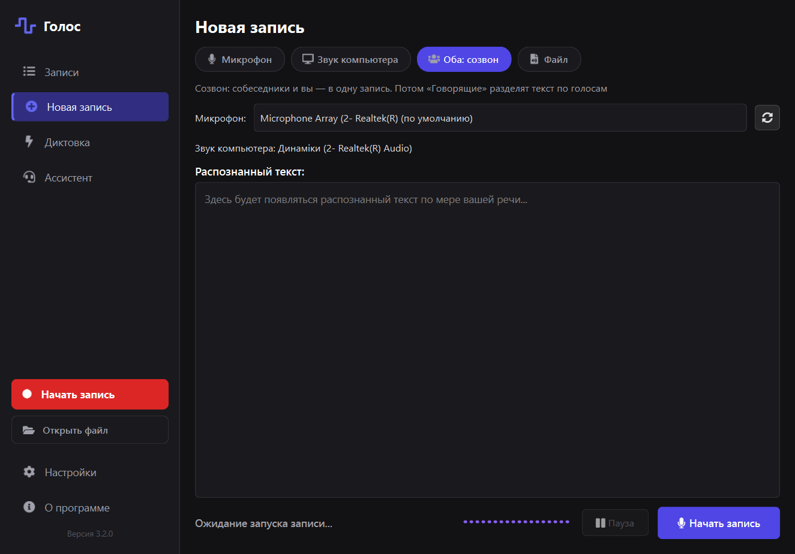
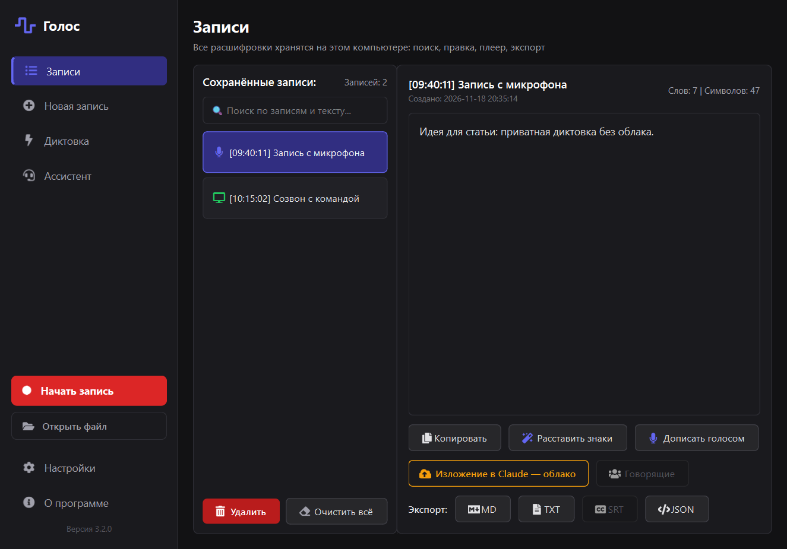
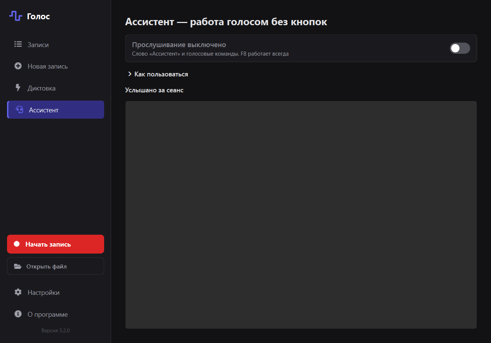
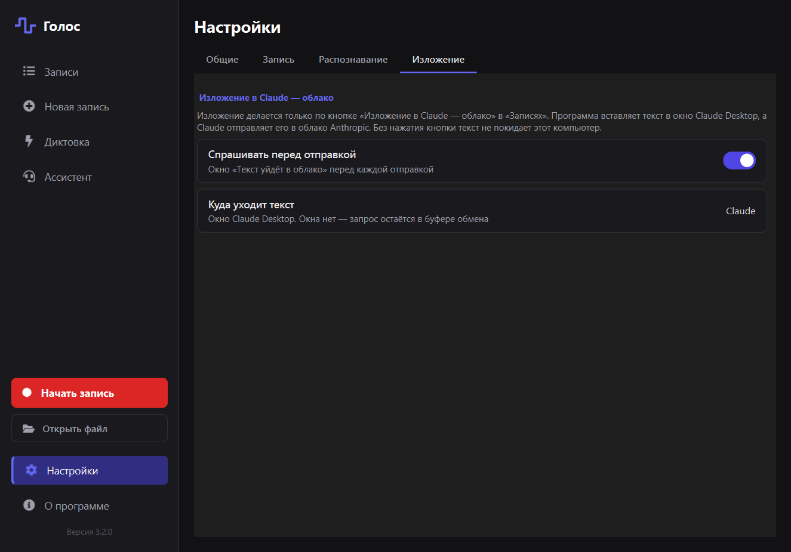

# Голос (Holos)

[Русский](README.md) • [English](README.en.md)

**Говорите — текст появляется в любом окне. Без интернета, без подписки, бесплатно.**

### Открытый код • Речь не уходит с компьютера • Бесплатно

**Ролик со звуком — 1:30:**

https://github.com/user-attachments/assets/ff9e236c-67b1-4a2a-91bb-362a86bd3111

---

Оглавление

- [Почему Голос?](#почему-голос)
- [Установка](#установка)
- [Возможности в деле](#возможности-в-деле)
- [Чем отличается](#чем-отличается)
- [Приватность](#приватность)
- [Для разработчиков](#для-разработчиков)
- [Благодарности](#благодарности)
- [Лицензия](#лицензия)

## Почему Голос?

- **Приватно.** Речь распознаётся на вашем компьютере. Звук и текст никуда не уходят.
- **Бесплатно.** Ни подписки, ни ключей, ни пробного срока.
- **Без интернета.** Работает в поезде, в подвале, при отключениях.
- **Под русский и украинский.** Лучшие открытые модели для каждого языка, знаки препинания — сами.

## Установка

| Система | Загрузка | Что сделать |
|---|---|---|
| **Windows 10 / 11 (x64)** | [Holos-Setup.exe](https://github.com/gof020466-stack/holos-app/releases/latest) | Двойной щелчок → язык → папка → «Установить». Права администратора не нужны |
| **Обновление** | [Holos-Update.exe](https://github.com/gof020466-stack/holos-app/releases/latest) | Ставится поверх, модели заново не качает |
| **Linux** | скоро | — |

> **Официальные сборки — только на странице [Releases](https://github.com/gof020466-stack/holos-app/releases).** Python и модели — внутри установщика. Требования: Windows 10 или 11, 64 бита; память — от 4 ГБ, лучше 8 ГБ (программа с загруженной моделью занимает около 0,9 ГБ); место на диске — 2 ГБ; видеокарта не нужна; интернет не нужен.

После установки: курсор в любое окно → **F8** → говорите → **F8**.

> **Ставится самостоятельно, за несколько минут.** Нужна помощь — поставим и научим: настроим под ваши задачи и свяжем с Claude. Напишите в [Issues](https://github.com/gof020466-stack/holos-app/issues) с пометкой «Установка».

## Возможности в деле

### ⌨️ Диктовка в любое окно
F8 — и текст идёт туда, где курсор: письмо, мессенджер, документ. Без рук: «начать диктовку» … «стоп запись».

### 🎙️ Запись созвона
Zoom, Telegram, любой звонок. Собеседники — из звука компьютера, вы — из микрофона, в одну запись. Пауз сколько угодно — запись одна.

### 👥 Кто что сказал
«Говорящие» делят расшифровку по голосам — у созвона и у любого файла.

### 📂 Расшифровка файлов
Аудио и видео — в текст. Плеер над текстом: клик по слову — перемотка к нему.

### 🗣️ «Ассистент» — команды голосом
«Ассистент, …» — фраза уходит в Claude Desktop и отправляется сама. Музыкой Голос управляет сам: пауза, громче, следующий.

### 📝 Краткое изложение — только по кнопке
О чём говорили, решения, задачи, кто что сказал — через Claude. Перед первой отправкой — предупреждение.

### 📤 Экспорт
Заметка Markdown для Obsidian, TXT, субтитры SRT для YouTube, JSON со временем каждого слова.

### 🌐 Три языка интерфейса
Русский, українська, English.

## Чем отличается

| | Голос | Meetily (бесплатная версия) |
|---|---|---|
| Распознавание на компьютере | да | да |
| Цена | бесплатно | бесплатно; есть платная Pro |
| Запись созвона | да | да |
| Кто что сказал | да | только в Pro |
| Модель для русского | GigaAM v3 | Whisper |

Данные Meetily — из его README, ноябрь 2026.

## Приватность

- Распознавание — на вашем компьютере. Интернет для работы не нужен.
- Записи, тексты и настройки хранятся только у вас.
- Единственный путь в облако — кнопка «Изложение в Claude». Перед первой отправкой — предупреждение.
- Проверка обновлений — только если вы согласились при первом запуске; выключается в «Настройках».
- Код открыт: проверить это может каждый.

## Для разработчиков

Python, движок распознавания — [sherpa-onnx](https://github.com/k2-fsa/sherpa-onnx). Модели в репозиторий не входят. Устройство программы и сборка установщика — [DEVELOPER.md](DEVELOPER.md). Ошибки и идеи — в [Issues](https://github.com/gof020466-stack/holos-app/issues).

## Благодарности

- **Сбер** — модель GigaAM v3 (русский).
- **NVIDIA** — Parakeet TDT v3; **moondream** — Parakeet Ultra, сборка ONNX — **mrfakename** (украинский, английский и другие).
- **Alpha Cephei** — Vosk (служебные модели: нарезка речи, голосовые команды).
- **pyannote** и **3D-Speaker** — модели для разделения говорящих.
- **k2-fsa** — sherpa-onnx; **FFmpeg** (сборка LGPL).

Лицензии всех моделей и библиотек — [THIRD_PARTY_LICENSES.md](THIRD_PARTY_LICENSES.md).

## Лицензия

MIT. Пользуйтесь свободно.

Авторы: Бак + Claude, 2026.
